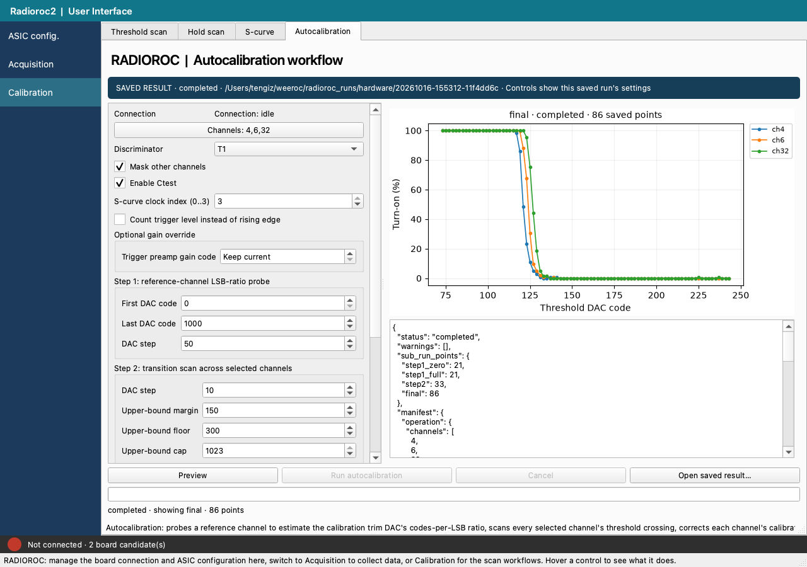

# RADIOROC tools

[](https://github.com/fruth-manenti-lab/weeroc/actions/workflows/python.yml)


An independent desktop application and Python toolkit for commissioning a
WEEROC RADIOROC 2 evaluation board and taking data from silicon
photomultipliers (SiPMs).

The project began because the supplied application was unreliable on our lab
setup. It now supports the full loop from configuring the ASIC to acquiring,
plotting, saving and reopening measurements. Simulation mode makes most of the
workflow usable without a board.



*A real saved autocalibration result reopened without rerunning the hardware.*

> This is research software developed in the Fruth–Manenti lab, not an official
> WEEROC product. Hardware support is based on the board and firmware available
> to our group.

## What works today

| Area | Current status |
| --- | --- |
| Desktop app | ASIC configuration, acquisition, threshold scans, S-curves, hold scans and autocalibration |
| Reproducibility | Saved configurations, run metadata, raw events, plots and saved-run replay |
| Offline use | Simulation mode is clearly labelled and does not require hardware |
| Analysis | Threshold and hold summaries, spectra and muon-rate analysis |
| Hardware | Used with a real RADIOROC 2 board on macOS |
| Automated checks | More than 700 offline tests across 64 test files |
| CI | Ubuntu 24.04 and macOS 14, using Python 3.11 and 3.13 |
| Windows | Not yet tested |

See [the public project status](docs/public_status.md) for the boundary between
verified, simulated and experimental features.

## Try it without hardware

Python 3.11 or newer is required. Conda is the shortest route:

```bash
git clone https://github.com/fruth-manenti-lab/weeroc.git
cd weeroc
conda env create -f environment.yml
conda activate radioroc-app
radioroc-desktop
```

Choose **Simulation** in the application. Simulated runs are marked
**SIMULATION** throughout and are saved separately from hardware runs.

For a plain virtual environment, updating an existing checkout, and platform
notes, use the [installation guide](docs/installation_guide.md).

## Working with the board

The desktop application and command-line tools support:

- ASIC configuration with save/load and known presets
- repeated ADC acquisition with spectra and raw event storage
- trigger-threshold and S-curve scans
- internal and external hold scans
- autocalibration and per-channel calibration workflows
- saved-run replay and offline analysis
- muon-coincidence inspection and rate analysis

Start with the [bench runbook](docs/bench_runbook.md) and the
[installation guide](docs/installation_guide.md). The tested macOS control port
was `/dev/cu.usbserial-RD3_320`; Linux permissions and Windows driver behaviour
depend on the local setup.

### Safety model

- Write-capable command-line tools are dry-run by default. Hardware changes
  require the explicit `--execute` flag.
- Only one process should control the board at a time.
- Live tests require an operator to verify power, cabling, limits and the
  intended board state.
- Instrument-assisted bench work described in the project logs was performed
  within explicit operator-approved limits. It is not part of the unattended
  offline test suite.
- Generated measurements belong under `radioroc_runs/`, which is ignored by
  git. Treat measured data as irreplaceable.

## Useful commands

List candidate ports without opening them:

```bash
radioroc ports --json
```

Run the offline development checks:

```bash
python tools/check_development.py
```

Read the FPGA status word:

```bash
python scripts/radioroc_check_connection.py
```

Apply and verify the default ASIC configuration only after checking the bench:

```bash
python scripts/radioroc_apply_defaults.py --execute --verify --verify-limit 0
```

The command-line scans accept JSON presets from `configs/presets/`. Run any
command with `--help` before using it on hardware.

## Repository guide

- `src/radioroc/`: packaged protocol, transport, application, data and GUI code
- `scripts/`: command-line acquisition, calibration and plotting tools
- `configs/`: the default ASIC table and reusable workflow presets
- `tests/`: offline unit, integration, simulation and GUI tests
- `docs/installation_guide.md`: installation and first simulation run
- `docs/bench_runbook.md`: safe setup and recovery notes for the lab bench
- `docs/muon_rate_measurement_guide.md`: coincidence and rate workflow
- `docs/gamma_co60_guide.md`: Co-60 acquisition workflow
- `docs/project/SMOKE_TESTS.md`: operator-run hardware checks
- `IMPLEMENTATION_STATUS.md`: detailed engineering record and evidence log

Vendor installers, extracted binaries, local environments and generated run
outputs are intentionally excluded from the repository.

## Development

Development setup and CI-equivalent checks are documented in
[DEVELOPMENT.md](DEVELOPMENT.md). Pull requests run the offline suite, build a
wheel, verify the installed package, exercise analysis, and launch the desktop
application offscreen on both Ubuntu and macOS.

Hardware smoke tests are deliberately separate: they require board state,
cabling and, for some workflows, external instruments and an operator.

## License

Released under the [MIT License](LICENSE). Vendor documentation is linked from
[`docs/vendor/README.md`](docs/vendor/README.md) rather than redistributed.
