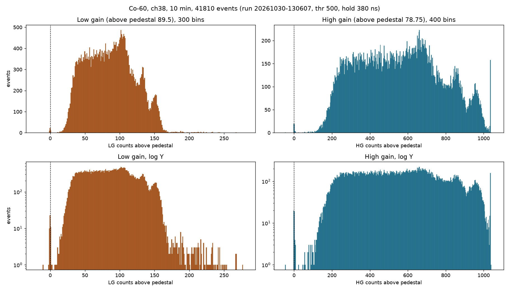
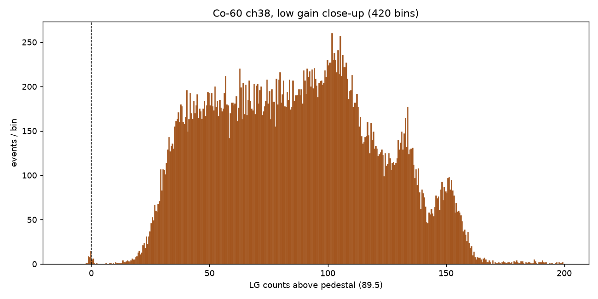
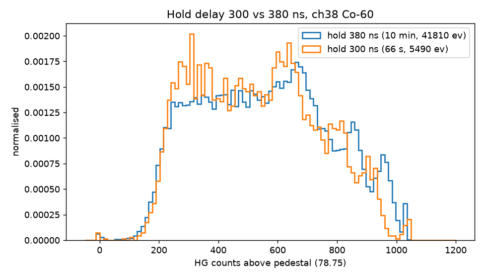

# 2026-10-30 — Co-60 gamma spectrum on ch38

## Goal

Take a self-triggered gamma spectrum of a Co-60 source on one plint (plastic scintillator + SiPM,
channel 38) with the RADIOROC desktop app, and make long runs survive. Source position, SiPM bias
voltage and current, and the detector geometry were not recorded in the app; add them here if known.

## Result in one line

A 10 minute run (41,810 events, run `20261030-130607-f343f11a`) gives a clean continuum that starts
about 30 low-gain counts above the pedestal, with a broad maximum near 100, a shoulder near 133 and a
second bump near 150 before it falls off at about 160. The same three features show in the high gain
channel. The settings that made the long run work were 10 acquisitions per batch (50 per batch lost
the board after 2 to 3 minutes) and a threshold of DAC 500.

Spectra are pedestal-subtracted (LG minus 89.5, HG minus 78.75), drawn as bar histograms. Low gain is
the better one to read: it does not saturate and the features are sharper.

## How it was taken

Settings of the good run, from its `metadata.json`:

| Setting | Value |
| --- | --- |
| Channel | 38, trigger channel 38 |
| Trigger | Simple trigger (type 0), source Individual trigger (3), discriminator T1 |
| Threshold DAC | 500 |
| Trigger preamp gain (paT) | 1 |
| Hold delay | 380 ns (conversion delay 400 ns) |
| Acquisitions per batch | 10 |
| Stop after | Acquisition time, 600 s |
| Result | 4181 batches, 41,810 events, completed, no retries, cleanup restored |

Steps:

1. Board powered and connected to the app (ASIC config loaded or default; the app does not record which).
2. Pedestals measured on ch38 with the Calibration page **Pedestals** step (forced-trigger
   acquisition, no signal): HG 78.75 (sd 2.6), LG 89.5 (sd 1.9), from
   `pedestals-20261030-153822-c7c22c6f`. The pedestal run used hold 380 ns and threshold 550.
3. Acquisition page with the settings above; the threshold followed the top bar. Short 10-batch
   runs first to check that batches finished, then the 10 minute timed run.
4. The spectrum is the run's `events.csv` for channel 38 with the pedestal subtracted
   (HG minus 78.75, LG minus 89.5). The plots were made with a small matplotlib script, not by the app.

## What the spectrum shows

- **Threshold edge:** the low-gain counts start to rise at about 20 above the pedestal and reach the
  plateau at about 35. In high gain the same edge sits near 150 to 250. Only 0.1% of events are within
  13 HG counts (5 pedestal sd) of the pedestal, so the events are real pulses, not pedestal triggers.
  Anything below the edge is not recorded.
- **Features (low gain):** plateau from 35 to about 90, maximum near 100 to 105, shoulder near 133,
  a second bump near 150, then a sharp fall by about 160, and a thin tail to 270.
- **Same features in high gain:** maximum near 670, shoulder near 850, bump near 960. Ratios to the
  maximum: 1.27 and 1.43 in HG, 1.30 and 1.47 in LG, so the structure is consistent between the two
  gains and is not an ADC artefact of one of them.
- **Candidate Compton edges:** a Co-60 plastic spectrum should show two blurred Compton edges at about
  0.96 and 1.12 MeV (ratio 1.17). The features are a candidate for those, but they are three, not
  two, and the ratios do not match, so this is not a confirmed identification. No energy calibration
  was done.
- **Saturation:** the last HG bin (about 1036 counts above pedestal) holds about 175 events, so the
  high-gain channel saturates there. The low-gain channel does not (largest value 440, one event).
- **Bins:** 300 bins for LG (1 count wide), 400 for HG, 420 in the close-up. The ADC values come in
  quarter-count steps (they are averages), so finer bins than this add noise, not information.
- **Hold delay 300 vs 380 ns:** a second run at hold 300 (66 s, 5490 events, cancelled) has a
  slightly lower median (526 against 556 HG counts above pedestal) and the same shape within the
  noise. Neither value was confirmed by a hold scan on ch38.

## What did not work first

| Run | Batch size | Result |
| --- | --- | --- |
| `20261030-123429-580109d0` | 50 | failed after 547 batches, about 120 s |
| `20261030-130300-d0b1af2f` | 50 | failed after 703 batches, about 172 s |
| `20261030-130607-f343f11a` | 10 | completed, 600 s |

- In the second failure, batch 703's reply was cut off at 9690 of 12804 bytes. The app retried it
  once, the board did not answer within 3 s, and the run ended with `TransportTimeoutError`.
  Cleanup failed because the board was silent, so the run's temporary settings were not restored and
  the board was no longer connected afterwards (probably needs a power-cycle).
- With 10 acquisitions per batch the same settings ran for the full 10 minutes with no retries.
  This was one run each way, not a systematic test; the cause of the board going silent is unknown.
- **Event rate:** the 50-per-batch runs read about 204 to 228 events/s; the 10-per-batch run read
  about 70 events/s. A rate that depends on batch size is the readout speed, not the source rate, so
  the real trigger rate on ch38 at threshold 500 is at least that high. Earlier notes called about
  230 events/s the trigger rate; that reading was wrong.

## App changes made today (merged as PR #12)

ASIC config Save/Load config, acquisition stop after time with a progress bar, spectra X range and
Subtract pedestal, wheel guard on spin boxes and dropdowns, hold scan raw points with a profile fit,
batch retry on a cut-off reply, and cleanup that stops after the first timeout. The Co-60 procedure
is in `docs/gamma_co60_guide.md`.

## Hypothesis from Danish: undershoot from unterminated coax (untested)

Relayed in chat after comparing our hold scans with Figure 19 of the vendor user guide (hold scan
with external hold, track and hold). The vendor curve rises, falls and settles on a flat baseline. Our
single-channel self-trigger hold scans on 2026-10-27 went below the baseline beyond about 140 ns
(`IMPLEMENTATION_STATUS.md`, RADIOROC 47).

Danish's idea, in the chat:

- The vendor plot shows no undershoot; ours does.
- A severe impedance mismatch could make the signal oscillate a little, which would show as
  undershoot.
- None of the coax ends has been terminated in 50 ohms, "which in hindsight is probably not good".
- A faulty edgeboard was also floated as a possible cause.

Status: nothing has been tested. It is not known which coax runs are involved, whether the
undershoot is on the scintillator/SiPM signal path or in the board's shaper, or whether the pulse
generator path (Ctest) shows the same. A first check would be a hold scan with the coax ends
terminated in 50 ohms (tee plus terminator) and the same settings, to see whether the undershoot
shrinks.

## Open items

- Why the board goes silent mid-reply at 50 per batch (batch size, rate, USB link) is not known.
- TQ trigger test not done. It needs ThresholdQ, the TQ mask, source NORTQ and Main > Trigger
  selection (Global TQ) set, then a new hold scan. The vendor Windows app has no TQ option in its
  threshold, S-curve or hold scan.
- Hold delay for ch38: 380 ns was used without a measured origin; a self-trigger hold scan on ch38
  would settle it.
- No energy calibration; the 670/850 structure is not identified.
- Source position, bias voltage and current were not recorded.
- Undershoot after the pulse in hold scans (see the hypothesis from Danish): terminate the coax
  ends in 50 ohms and repeat a hold scan; consider the edgeboard if it persists.
